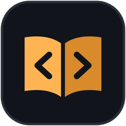

<div align="center">



# Codex

> Un solo lugar para **instalar, actualizar y abrir** mis apps de Windows: eliges una app, Codex baja su instalador oficial, verifica su firma SHA-256 y la deja lista.

[](CHANGELOG.md)
[](https://github.com/MiguelBigott/codex/actions/workflows/ci.yml)
[](https://go.dev)
[](#-instalación)
[](#-catálogo)
[](web/fonts)

[Historial de versiones](CHANGELOG.md) · [Releases](../../releases) · [Descargar el instalador](../../releases/latest)


<sub>Panel de actividad generado a diario por <a href=".github/workflows/estadisticas.yml">GitHub Actions</a>, sin servicios de terceros.</sub>

</div>

---

## 📖 Índice

- [Funciones](#-funciones)
- [Catálogo](#-catálogo)
- [Stack](#-stack)
- [Instalación](#-instalación)
- [Compilar](#️-compilar)
- [Añadir una app](#-añadir-una-app)
- [Seguridad](#-seguridad)
- [Créditos](#️-créditos)

## ✨ Funciones

- **La biblioteca**: las apps del catálogo en cuadrícula o en tabla, con filtros (todas, instaladas, con actualización, sin instalar), orden y búsqueda.
- **Sabe qué tienes**: detecta qué apps están instaladas y en qué versión leyendo el registro de Windows, aunque no las hayas instalado desde Codex.
- **Siempre al día**: consulta la última versión de cada app en sus releases de GitHub y marca las que tienen actualización. Recuerda lo último que consultó aunque lo cierres, así que casi no gasta el límite de consultas de GitHub; si GitHub pausa las consultas, sigue mostrando las últimas versiones conocidas.
- **Instala con un clic**: baja el instalador, **verifica su SHA-256** y lo ejecuta como administrador (Windows muestra el aviso de UAC). Acepta setups `.exe` (NSIS) y paquetes `.msi`, y también desinstala.
- **Se actualiza solo**: avisa cuando hay una versión nueva del propio launcher y se pone al día con un clic.
- **Skin «Terminal»**: minúsculas monoespaciadas sobre fondo oscuro, acento ámbar y el cursor de `~/codex_`.
- **Ventana propia**: ventana nativa de Windows (WebView2) con su icono nítido en la barra de tareas, sin barra de título del sistema.

## 📚 Catálogo

Las apps de ArtCraft llevan el mismo número y los mismos colores que en su propio launcher (PhotoCraft 01 … GridCraft 13).

| # | App | Qué hace | Autor | Repositorio |
|---|---|---|---|---|
|  |  **Clipvault** | Descarga de video y audio · MP4 o MP3 con portada y metadatos | Miguel Bigott | [MiguelBigott/clipvault](https://github.com/MiguelBigott/clipvault) |
|  |  **PNGWebp** | Conversión de imágenes a WebP · PNG o JPG con la máxima calidad y el menor peso | Miguel Bigott | [MiguelBigott/pngwebp](https://github.com/MiguelBigott/pngwebp) |
| 01 |  **PhotoCraft** | Edición de imágenes · Capas, ajustes y archivos PSD | [ArtCraft](https://getartcraft.com) | [storytold/photocraft](https://github.com/storytold/photocraft) |
| 02 |  **VectorCraft** | Ilustración vectorial · Trazos y formas al estilo de Illustrator | [ArtCraft](https://getartcraft.com) | [storytold/vectorcraft](https://github.com/storytold/vectorcraft) |
| 03 |  **FilmCraft** | Edición de video, color y sonido · Montaje no lineal en línea de tiempo | [ArtCraft](https://getartcraft.com) | [storytold/filmcraft](https://github.com/storytold/filmcraft) |
| 04 |  **LightCraft** | Revelado y edición de fotos · Ajustes no destructivos al estilo de Lightroom | [ArtCraft](https://getartcraft.com) | [storytold/lightcraft](https://github.com/storytold/lightcraft) |
| 05 |  **PdfCraft** | Leer, organizar y proteger PDF · Une, separa, comenta, firma y protege | [ArtCraft](https://getartcraft.com) | [storytold/pdfcraft](https://github.com/storytold/pdfcraft) |
| 06 |  **EffectCraft** | Gráficos en movimiento y efectos visuales · Efectos y animación al estilo de After Effects | [ArtCraft](https://getartcraft.com) | [storytold/effectcraft](https://github.com/storytold/effectcraft) |
| 07 |  **DesignCraft** | Maquetación de páginas · Revistas y folletos al estilo de InDesign | [ArtCraft](https://getartcraft.com) | [storytold/designcraft](https://github.com/storytold/designcraft) |
| 08 |  **FigCraft** | Diseño de interfaces y prototipos · Pantallas y prototipos al estilo de Figma | [ArtCraft](https://getartcraft.com) | [storytold/figcraft](https://github.com/storytold/figcraft) |
| 09 |  **WordCraft** | Escritura y diseño de documentos · Documentos al estilo de Microsoft Word | [ArtCraft](https://getartcraft.com) | [storytold/wordcraft](https://github.com/storytold/wordcraft) |
| 10 |  **SoundCraft** | Grabación, edición y mezcla de audio · Estudio de audio al estilo de Pro Tools | [ArtCraft](https://getartcraft.com) | [storytold/soundcraft](https://github.com/storytold/soundcraft) |
| 11 |  **DeckCraft** | Presentaciones y diapositivas · Diapositivas al estilo de PowerPoint | [ArtCraft](https://getartcraft.com) | [storytold/deckcraft](https://github.com/storytold/deckcraft) |
| 12 |  **CADCraft** | Diseño y dibujo técnico · Planos al estilo de AutoCAD | [ArtCraft](https://getartcraft.com) | [storytold/cadcraft](https://github.com/storytold/cadcraft) |
| 13 |  **GridCraft** | Hojas de cálculo y datos · Celdas y fórmulas al estilo de Excel | [ArtCraft](https://getartcraft.com) | [storytold/gridcraft](https://github.com/storytold/gridcraft) |

Cada app nueva entra al catálogo cuando tiene su primera versión publicada.

## 🧱 Stack

| Capa | Tecnología |
|---|---|
| Aplicación | [Go](https://go.dev): servidor local con la biblioteca estándar |
| Ventana | [WebView2](https://developer.microsoft.com/microsoft-edge/webview2/) con [go-webview2](https://github.com/jchv/go-webview2) |
| Interfaz | HTML, CSS y JavaScript embebidos (`go:embed`), tipografías Inter y Space Mono |
| Versiones | API de releases de GitHub, con caché por ETag |
| Instalador | [NSIS](https://nsis.sourceforge.io) |
| CI | GitHub Actions |

## 📦 Instalación

Descarga `Codex-Setup-<versión>.exe` desde [Releases](../../releases/latest) y ejecútalo.

- Todo queda en `C:\Program Files\Codex`: el launcher (`Codex.exe`) y una subcarpeta por app (`C:\Program Files\Codex\<App>`).
- La configuración vive en `%LOCALAPPDATA%\Codex`.
- El instalador ofrece crear un acceso directo en el escritorio.

## 🛠️ Compilar

Requisitos: [Go](https://go.dev/dl) 1.27 o superior, [NSIS](https://nsis.sourceforge.io) y go-winres (`go install github.com/tc-hib/go-winres@latest`).

```powershell
.\build\compilar.ps1
```

Genera `dist\Codex.exe` y `dist\Codex-Setup-<versión>.exe`. La versión se toma de `const Version` en `main.go`.

El logo «Códice cerrado» se define en `build/generar_logo.py`, que escribe `web/logo.svg`, `build/logo.png`, `build/app.ico` (con una versión simplificada para 16-32 px) y `build/lateral.bmp` (requiere Python con Pillow y Microsoft Edge):

```powershell
python build\generar_logo.py
```

Para revisar la interfaz en un navegador, sin ventana, ejecuta el launcher con `CODEX_NAVEGADOR=1`: la dirección queda en `%LOCALAPPDATA%\Codex\url-desarrollo.txt`.

<details>
<summary>Cómo está hecho</summary>

| Archivo | Contenido |
|---|---|
| `main.go` | Arranque, instancia única y ventana |
| `ventana.go` | Ventana nativa sin barra de título (el encabezado de la interfaz hace de barra) |
| `servidor.go` | Servidor local (solo `127.0.0.1`, con clave por sesión) que usa la interfaz |
| `launcher.go` | Estado, revisión de versiones, descargas verificadas e instalaciones (NSIS y MSI) |
| `releases.go` | Consulta a la API de GitHub y sumas SHA-256 |
| `instalados.go` | Apps instaladas según el registro de Windows |
| `elevar.go` | Ejecución como administrador (UAC) |
| `catalogo.go`, `catalogo.json` | El catálogo de apps |
| `web/` | Interfaz (HTML, CSS y JS) |
| `build/` | Logo, instalador NSIS y script de compilación |

</details>

## ➕ Añadir una app

Cada app vive en su propio repositorio público y se define en [`catalogo.json`](catalogo.json):

| Campo | Para qué |
|---|---|
| `id` | Identificador único |
| `nombre` + `sufijo` | Se muestran juntos (`Clip` + `vault`) |
| `descripcion`, `similar` | Las líneas bajo el nombre |
| `autor` | Crédito para apps de terceros («de ArtCraft») |
| `color` | Color de la app (icono de respaldo) |
| `icono` | URL `https` de su icono oficial (opcional) |
| `categoria` | Sección donde aparece |
| `repo` | Repositorio de GitHub (`usuario/repo`) donde publica sus versiones |
| `web` | Sitio web (opcional) |
| `formato` | `nsis` (setup `.exe`, por defecto) o `msi` |
| `propiedadCarpeta` | Solo MSI: propiedad que fija la carpeta (p. ej. `INSTALLFOLDER`) |
| `nombreRegistro` | Nombre con el que se registra en Windows (por defecto `nombre`+`sufijo`) |
| `ejecutable` | `.exe` dentro de su carpeta (por defecto `nombre`+`sufijo`.exe) |
| `ejemplo` | `true` para mostrarla como «Próximamente» |

Cada release debe incluir el instalador para Windows x64 (un `.exe` con `setup` en el nombre, o un `.msi` con `x64`) y su suma SHA-256: GitHub ya la publica para cada archivo, o puede ir en un `SHA256SUMS.txt`.

## 🔐 Seguridad

- **Sin suma, no instala**: cada instalador se compara con su SHA-256 antes de ejecutarse; si no coincide, se borra.
- **Solo desde GitHub**: los instaladores se bajan de los releases oficiales de cada repositorio del catálogo, por HTTPS.
- **Servidor cerrado**: la interfaz habla con un servidor en `127.0.0.1` que exige una clave nueva en cada sesión.
- **Administrador solo para instalar**: el launcher corre como usuario normal y pide permiso (UAC) únicamente al instalar o desinstalar.
- **CI con acciones fijadas por SHA** y permisos mínimos en cada workflow.

## 🖋️ Créditos

- [PhotoCraft](https://github.com/storytold/photocraft), [LightCraft](https://github.com/storytold/lightcraft), [VectorCraft](https://github.com/storytold/vectorcraft), [DesignCraft](https://github.com/storytold/designcraft), [FigCraft](https://github.com/storytold/figcraft), [FilmCraft](https://github.com/storytold/filmcraft), [EffectCraft](https://github.com/storytold/effectcraft), [SoundCraft](https://github.com/storytold/soundcraft), [WordCraft](https://github.com/storytold/wordcraft), [GridCraft](https://github.com/storytold/gridcraft), [DeckCraft](https://github.com/storytold/deckcraft), [PdfCraft](https://github.com/storytold/pdfcraft) y [CADCraft](https://github.com/storytold/cadcraft) son de [ArtCraft](https://getartcraft.com), con licencia Apache 2.0. Codex las muestra con su nombre, su icono oficial y su crédito, y las descarga de sus releases oficiales sin modificarlas.
- Tipografías [Inter](https://rsms.me/inter/) y [Space Mono](https://fonts.google.com/specimen/Space+Mono), con licencia SIL Open Font License.
- Ventana con [go-webview2](https://github.com/jchv/go-webview2) (MIT).

<div align="center">
<sub>Hecho por <a href="https://github.com/MiguelBigott">Miguel Bigott</a></sub>
</div>
