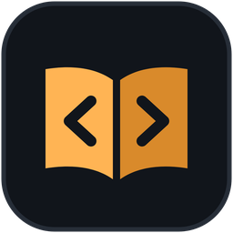
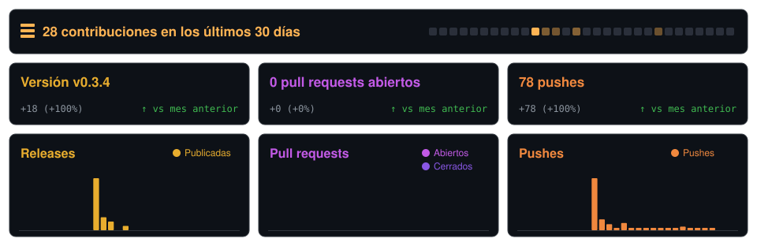

<div align="center">



# Codex

> Un solo lugar para **instalar, actualizar y abrir** mis apps de Windows: eliges una app, Codex baja su instalador oficial, verifica su firma SHA-256 y la deja lista.

[](CHANGELOG.md)
[](https://github.com/MiguelBigott/codex/actions/workflows/ci.yml)
[](https://go.dev)
[](#-instalación)
[](#-catálogo)
[](LICENSE)

[Historial de versiones](CHANGELOG.md) · [Releases](../../releases) · [Descargar el instalador](../../releases/latest)



<sub>Panel de actividad generado a diario por <a href=".github/workflows/estadisticas.yml">GitHub Actions</a>, sin servicios de terceros.</sub>

</div>

---

## 📖 Índice

- [Funciones](#-funciones)
- [Catálogo](#-catálogo)
- [Stack](#-stack)
- [Instalación](#-instalación)
- [Compilar](#️-compilar)
- [Añadir una app](#-añadir-una-app)
- [Seguridad](#-seguridad)
- [Licencia](#️-licencia)
- [Créditos](#️-créditos)

## ✨ Funciones

- **La biblioteca**: las apps del catálogo en cuadrícula o en tabla, con filtros (todas, instaladas, con actualización, sin instalar), orden y búsqueda.
- **Panel de detalles**: un clic en una app abre su página, como en el launcher de ArtCraft: titular, descripción, funciones y plataformas, y de la última versión el número, la fecha, el tamaño y las novedades. Está en español y en inglés (se abre en el idioma de Codex y un botón ES / EN lo cambia); las flechas pasan de app y Esc lo cierra.
- **Sabe qué tienes**: detecta qué apps están instaladas y en qué versión leyendo el registro de Windows, aunque no las hayas instalado desde Codex.
- **Siempre al día**: consulta la última versión de cada app en sus releases de GitHub y marca las que tienen actualización. Mira primero la página pública de releases, que no cuenta para el límite de consultas de GitHub, y usa la API solo cuando hay una versión nueva; si GitHub pausa las consultas, sigue mostrando las últimas versiones conocidas.
- **Instala con un clic**: baja el instalador, **verifica su SHA-256** y lo ejecuta como administrador (Windows muestra el aviso de UAC). Acepta setups `.exe` (NSIS) y paquetes `.msi`, y también desinstala.
- **Accesos directos**: crea uno para cada app instalada del catálogo, tanto las propias como las de ArtCraft; al iniciar, repara los que falten y actualiza los que apunten a una ruta anterior.
- **Se actualiza solo**: avisa cuando hay una versión nueva del propio launcher y se pone al día con un clic.
- **Skin «Terminal»**: fondo negro con una rejilla suave, cada app en su propia tarjeta de esquinas rectas (versión arriba, nombre junto al icono y barra de botones al pie), textos en Inter, versiones en monoespaciada y un solo acento ámbar, con el cursor de `~/codex_`.
- **Ventana propia**: ventana nativa de Windows (WebView2) con su icono nítido en la barra de tareas, sin barra de título del sistema.
- **En segundo plano**: al cerrar la ventana, Codex sigue en la bandeja del sistema (clic en el icono para volver, clic derecho para salir), y puede abrirse solo al iniciar sesión. Las dos opciones están en Ajustes.
- **8 idiomas**: español, inglés, francés, alemán, ruso, portugués, chino y japonés. Por defecto usa el idioma del PC (si no es ninguno de esos, inglés), y se puede elegir otro en Ajustes.

## 📚 Catálogo

La tabla numera las apps en el orden del catálogo, desde ClipVault (01) hasta OBS Studio (24). Los colores de ArtCraft son los mismos que en su propio launcher. La colección Gallery reúne apps de terceros: Orchard, SolidCraft, MailCraft (de la comunidad, que el launcher de ArtCraft también instala) y OBS Studio.

| # | App | Qué hace | Autor | Repositorio |
|---|---|---|---|---|
| 01 |  **ClipVault** | Descarga de video y audio · MP4 o MP3 con portada y metadatos | Miguel Bigott | [MiguelBigott/clipvault](https://github.com/MiguelBigott/clipvault) |
| 02 |  **PngWebp** | Conversión de imágenes a WebP · PNG o JPG con la máxima calidad y el menor peso | Miguel Bigott | [MiguelBigott/pngwebp](https://github.com/MiguelBigott/pngwebp) |
| 03 |  **PdfEpub** | Conversión de PDF a EPUB · Libros con portada, datos y capítulos editables | Miguel Bigott | [MiguelBigott/pdfepub](https://github.com/MiguelBigott/pdfepub) |
| 04 |  **PhotoCraft** | Edición de imágenes | [ArtCraft](https://getartcraft.com) | [storytold/photocraft](https://github.com/storytold/photocraft) |
| 05 |  **VectorCraft** | Ilustración vectorial | [ArtCraft](https://getartcraft.com) | [storytold/vectorcraft](https://github.com/storytold/vectorcraft) |
| 06 |  **FilmCraft** | Edición de video, color y sonido | [ArtCraft](https://getartcraft.com) | [storytold/filmcraft](https://github.com/storytold/filmcraft) |
| 07 |  **LightCraft** | Revelado y edición de fotos | [ArtCraft](https://getartcraft.com) | [storytold/lightcraft](https://github.com/storytold/lightcraft) |
| 08 |  **PdfCraft** | Leer, organizar y proteger PDF | [ArtCraft](https://getartcraft.com) | [storytold/pdfcraft](https://github.com/storytold/pdfcraft) |
| 09 |  **EffectCraft** | Gráficos en movimiento y efectos visuales | [ArtCraft](https://getartcraft.com) | [storytold/effectcraft](https://github.com/storytold/effectcraft) |
| 10 |  **DesignCraft** | Maquetación de páginas | [ArtCraft](https://getartcraft.com) | [storytold/designcraft](https://github.com/storytold/designcraft) |
| 11 |  **FigCraft** | Diseño de interfaces y prototipos | [ArtCraft](https://getartcraft.com) | [storytold/figcraft](https://github.com/storytold/figcraft) |
| 12 |  **TextureCraft** | Pintura de texturas 3D | [ArtCraft](https://getartcraft.com) | [storytold/texturecraft](https://github.com/storytold/texturecraft) |
| 13 |  **MaterialCraft** | Diseño de materiales procedurales | [ArtCraft](https://getartcraft.com) | [storytold/materialcraft](https://github.com/storytold/materialcraft) |
| 14 |  **WordCraft** | Escritura y diseño de documentos | [ArtCraft](https://getartcraft.com) | [storytold/wordcraft](https://github.com/storytold/wordcraft) |
| 15 |  **SoundCraft** | Grabación, edición y mezcla de audio | [ArtCraft](https://getartcraft.com) | [storytold/soundcraft](https://github.com/storytold/soundcraft) |
| 16 |  **DeckCraft** | Presentaciones y diapositivas | [ArtCraft](https://getartcraft.com) | [storytold/deckcraft](https://github.com/storytold/deckcraft) |
| 17 |  **CADCraft** | Diseño y dibujo técnico | [ArtCraft](https://getartcraft.com) | [storytold/cadcraft](https://github.com/storytold/cadcraft) |
| 18 |  **GridCraft** | Hojas de cálculo y datos | [ArtCraft](https://getartcraft.com) | [storytold/gridcraft](https://github.com/storytold/gridcraft) |
| 19 |  **Craft Anything** | Descubre cómo funciona cualquier programa y crea el tuyo | [ArtCraft](https://getartcraft.com) | [storytold/craft-anything](https://github.com/storytold/craft-anything) |
| 20 |  **AniCraft** | Animación vectorial 2D | [ArtCraft](https://getartcraft.com) | [storytold/anicraft](https://github.com/storytold/anicraft) |
| 21 |  **Orchard** | Reproductor de música para escritorio | [SFG545](https://sfg545.dev/orchard) | [sfg5453/orchard](https://github.com/sfg5453/orchard) |
| 22 |  **SolidCraft** | CAD 3D paramétrico | [Tangency Labs](https://solidcraft.io) | [tangency-labs/solidcraft](https://github.com/tangency-labs/solidcraft) |
| 23 |  **MailCraft** | Correo, calendario y contactos | [UCS Care Group](https://mailcraft.work) | [UCS-Care-Group/mailcraft](https://github.com/UCS-Care-Group/mailcraft) |
| 24 | **OBS Studio** | Grabación y transmisión de video en directo | [OBS Project](https://obsproject.com) | [obsproject/obs-studio](https://github.com/obsproject/obs-studio) |

Cada app nueva entra al catálogo cuando tiene su primera versión publicada.

## 🧱 Stack

| Capa | Tecnología |
|---|---|
| Aplicación | [Go](https://go.dev): servidor local con la biblioteca estándar |
| Ventana | [WebView2](https://developer.microsoft.com/microsoft-edge/webview2/) con [go-webview2](https://github.com/jchv/go-webview2) |
| Interfaz | HTML, CSS y JavaScript embebidos (`go:embed`), tipografías Inter y Space Mono |
| Versiones | API de releases de GitHub, con caché por ETag |
| Instalador | [NSIS](https://nsis.sourceforge.io) |
| CI | GitHub Actions |

## 📦 Instalación

Descarga `Codex-Setup-<versión>.exe` desde [Releases](../../releases/latest) y ejecútalo.

- Todo queda en `C:\Program Files\Codex`: el launcher (`Codex.exe`) y una subcarpeta por app (`C:\Program Files\Codex\<App>`).
- La configuración vive en `%LOCALAPPDATA%\Codex`.
- El instalador ofrece crear un acceso directo en el escritorio.
- Codex también crea el acceso directo de cada app instalada y comprueba los enlaces existentes al iniciar.

## 🛠️ Compilar

Requisitos: [Go](https://go.dev/dl) 1.27 o superior, [NSIS](https://nsis.sourceforge.io) y go-winres (`go install github.com/tc-hib/go-winres@latest`).

```powershell
.\build\compilar.ps1
```

Genera `dist\Codex.exe` y `dist\Codex-Setup-<versión>.exe`. La versión se toma de `const Version` en `main.go`.

El logo «Códice cerrado» se define en `build/generar_logo.py`, que escribe `web/logo.svg`, `build/logo.png`, `build/app.ico` (con una versión simplificada para 16-32 px) y `build/lateral.bmp` (requiere Python con Pillow y Microsoft Edge):

```powershell
python build\generar_logo.py
```

Para revisar la interfaz en un navegador, sin ventana, ejecuta el launcher con `CODEX_NAVEGADOR=1`: la dirección queda en `%LOCALAPPDATA%\Codex\url-desarrollo.txt`.

<details>
<summary>Cómo está hecho</summary>

| Archivo | Contenido |
|---|---|
| `main.go` | Arranque, instancia única y ventana |
| `ventana.go` | Ventana nativa sin barra de título (el encabezado de la interfaz hace de barra) |
| `servidor.go` | Servidor local (solo `127.0.0.1`, con clave por sesión) que usa la interfaz |
| `launcher.go` | Estado, revisión de versiones, descargas verificadas e instalaciones (NSIS y MSI) |
| `releases.go` | Consulta a la API de GitHub y sumas SHA-256 |
| `instalados.go` | Apps instaladas según el registro de Windows |
| `elevar.go` | Ejecución como administrador (UAC) |
| `catalogo.go`, `catalogo.json` | El catálogo de apps |
| `detalles.go`, `detalles.json` | Las páginas del panel de detalles (titular, descripción, funciones y plataformas), en español y en inglés |
| `web/` | Interfaz (HTML, CSS y JS) |
| `build/` | Logo, instalador NSIS y script de compilación |

</details>

## ➕ Añadir una app

Cada app vive en su propio repositorio público y se define en [`catalogo.json`](catalogo.json):

| Campo | Para qué |
|---|---|
| `id` | Identificador único |
| `nombre` + `sufijo` | Se muestran juntos (`Clip` + `vault`) |
| `descripcion`, `similar` | Las líneas bajo el nombre, en español |
| `traducciones` | Las mismas líneas en otros idiomas: `{"en": {"descripcion": "…", "similar": "…"}}`; lo que falte se muestra en español |
| `autor` | Crédito para apps de terceros («de ArtCraft») |
| `color` | Color de la app (icono de respaldo) |
| `icono` | URL `https` de su icono oficial (opcional) |
| `categoria` | Sección donde aparece |
| `repo` | Repositorio de GitHub (`usuario/repo`) donde publica sus versiones |
| `web` | Sitio web (opcional) |
| `formato` | `nsis` (setup `.exe`, por defecto) o `msi` |
| `propiedadCarpeta` | Solo MSI: propiedad que fija la carpeta (p. ej. `INSTALLFOLDER`) |
| `nombreRegistro` | Nombre con el que se registra en Windows (por defecto `nombre`+`sufijo`) |
| `ejecutable` | `.exe` dentro de su carpeta (por defecto `nombre`+`sufijo`.exe) |
| `ejemplo` | `true` para mostrarla como «Próximamente» |
| `porUsuario` | `true` si su instalador se instala solo para el usuario, sin permiso de administrador y en su propia carpeta |
| `seActualizaSola` | `true` si la app trae su propio actualizador: Codex no ofrece actualizaciones |
| `betas` | `true` para usar la versión beta más reciente con instalador si la estable no lo trae |

Cada release debe incluir el instalador para Windows x64 (un `.exe` con `setup` en el nombre, o un `.msi` con `x64`) y su suma SHA-256: GitHub ya la publica para cada archivo, o puede ir en un `SHA256SUMS.txt`.

## 🔐 Seguridad

- **Sin suma, no instala**: cada instalador se compara con su SHA-256 antes de ejecutarse; si no coincide, se borra.
- **Solo desde GitHub**: los instaladores se bajan de los releases oficiales de cada repositorio del catálogo, por HTTPS.
- **Servidor cerrado**: la interfaz habla con un servidor en `127.0.0.1` que exige una clave nueva en cada sesión.
- **Administrador solo para instalar**: el launcher corre como usuario normal y pide permiso (UAC) únicamente al instalar o desinstalar.
- **CI con acciones fijadas por SHA** y permisos mínimos en cada workflow.

## ⚖️ Licencia

**Creado por [Miguel Bigott](https://github.com/MiguelBigott)** y publicado con licencia [MIT](LICENSE): cualquiera puede usarlo, copiarlo, modificarlo y compartirlo libremente, también en sus propios proyectos, siempre que mantenga el aviso de autor. Se entrega tal cual, sin garantías.

Las apps del catálogo tienen sus propias licencias y Codex las descarga de sus releases oficiales sin modificarlas. Lo de terceros que va dentro de Codex (Go, go-webview2 y las tipografías) conserva su licencia; el instalador las deja en `LICENCIAS-TERCEROS.txt`, junto a la app.

## 🖋️ Créditos

- [PhotoCraft](https://github.com/storytold/photocraft), [VectorCraft](https://github.com/storytold/vectorcraft), [FilmCraft](https://github.com/storytold/filmcraft), [LightCraft](https://github.com/storytold/lightcraft), [PdfCraft](https://github.com/storytold/pdfcraft), [EffectCraft](https://github.com/storytold/effectcraft), [DesignCraft](https://github.com/storytold/designcraft), [FigCraft](https://github.com/storytold/figcraft), [TextureCraft](https://github.com/storytold/texturecraft), [MaterialCraft](https://github.com/storytold/materialcraft), [WordCraft](https://github.com/storytold/wordcraft), [SoundCraft](https://github.com/storytold/soundcraft), [DeckCraft](https://github.com/storytold/deckcraft), [CADCraft](https://github.com/storytold/cadcraft), [GridCraft](https://github.com/storytold/gridcraft), [Craft Anything](https://github.com/storytold/craft-anything) y [AniCraft](https://github.com/storytold/anicraft) son de [ArtCraft](https://getartcraft.com), con licencia Apache 2.0. Codex las muestra con su nombre, su icono oficial y su crédito, y las descarga de sus releases oficiales sin modificarlas. Los textos de su panel de detalles (y los de SolidCraft y MailCraft) vienen del catálogo de [su launcher](https://github.com/storytold/craft-launcher), tal cual en inglés y traducidos al español.
- [SolidCraft](https://github.com/tangency-labs/solidcraft) es de [Tangency Labs](https://solidcraft.io) y [MailCraft](https://github.com/UCS-Care-Group/mailcraft) de [UCS Care Group](https://mailcraft.work), ambas con licencia Apache 2.0: apps de la comunidad que el launcher de ArtCraft también instala. Codex las muestra con su icono oficial y su crédito, y las descarga de sus releases oficiales sin modificarlas.
- [Orchard](https://github.com/sfg5453/orchard) es de [SFG545](https://sfg545.dev/orchard), con licencia AGPL 3.0 (su motor de mezcla, PolyForm Shield). Codex la muestra con su icono oficial y su crédito, y baja su instalador oficial sin modificarlo; la app se mantiene al día con su propio actualizador.
- [OBS Studio](https://github.com/obsproject/obs-studio) es de [OBS Project](https://obsproject.com), con licencia GPL 2.0. Codex la muestra con su crédito y baja su instalador oficial de GitHub sin modificarlo.
- Tipografías [Inter](https://rsms.me/inter/) y [Space Mono](https://fonts.google.com/specimen/Space+Mono), con licencia SIL Open Font License.
- Ventana con [go-webview2](https://github.com/jchv/go-webview2) (MIT).

<div align="center">
<sub>Hecho por <a href="https://github.com/MiguelBigott">Miguel Bigott</a></sub>
</div>
